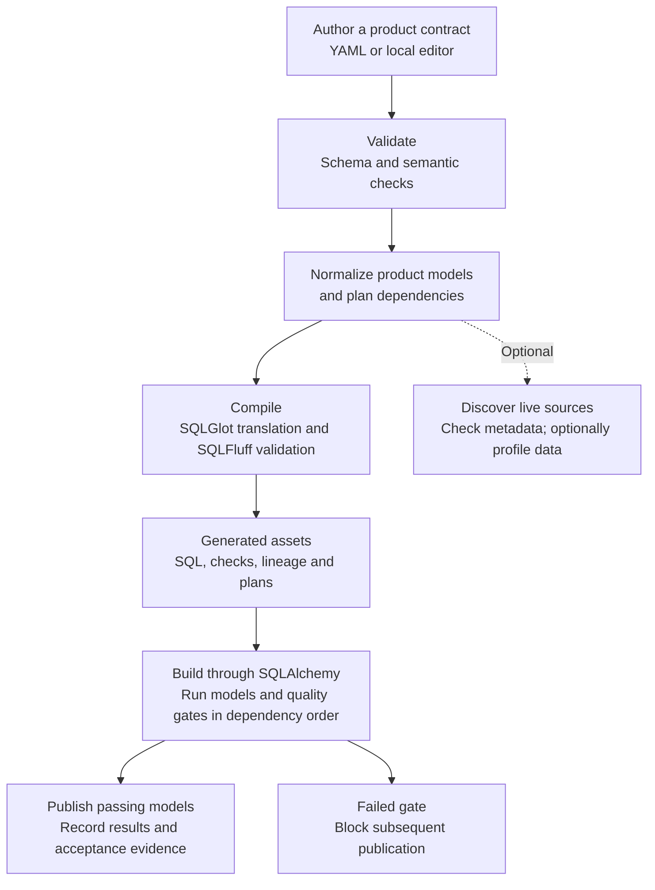

# CADEO
**CADEO:** **C**ontract-driven **A**utomation for **D**ata **E**ngineering & **O**rchestration helps take a data product from
business requirements to validated SQL with quality checks, publication and evidence.

## Why CADEO?

Data products often scatter their requirements, source assumptions, mapping
logic and checks across documents and code. That makes changes hard to trace and
leaves teams unsure what a successful run actually proves. CADEO brings these
decisions together in a versioned contract, then uses it to validate the design,
generate implementation assets and connect test results back to requirements.

One product can publish multiple related canonical models. Each model has its own
source-to-target mapping, checks and publication target, while the product remains
the unit of ownership. Author the contract as YAML or use the local visual editor;
both work with the same specification and services.

## How it works



Validation and compilation do not require a database. Discovery is optional;
building requires a configured connection and a supported publication strategy.
SQL dialect support is separate from database driver availability and safe native
publication. `cadeo dialects` and `cadeo engines` show the available options.

In short: author, validate, plan, compile, then optionally build and inspect the
evidence. The diagram renders on platforms that support Mermaid.

### The contract

| Section | Describes | Supports |
| --- | --- | --- |
| Definition | Business outcome, features and acceptance criteria | Requirement traceability and acceptance evidence |
| Model | Entities, grain, attributes, keys and relationships | Canonical models and relationship checks |
| Sources | Connections, datasets, columns and source contracts | Source validation and optional discovery |
| Mapping | Source bindings, joins, filters and expressions | Transformation SQL and field-level lineage |
| Assurance | Quality rules, reconciliation and tests | Quality gates and acceptance results |
| Delivery | Targets, execution, refresh and recovery | Publication assets and build configuration |

For detailed options, see [the multi-model example](#one-product-multiple-tables),
[CLI commands](#cli), [generated deliverables](#generated-deliverables), and
[validation and tests](#validation-and-tests). Repository examples require a
source checkout; the packaged tutorial does not.

## Install

CADEO requires Python 3.10 or later. From a checkout or unpacked source
distribution, install it with pip:

```bash
python -m pip install .
cadeo --version
```

For development, use `python -m pip install -e .` instead. SQLite works without
an additional database driver; optional drivers can be installed using extras,
for example `python -m pip install '.[duckdb]'` from the source directory. Use
`cadeo engines` to check driver availability and publication support. This source
installation does not assume that this version has been published to PyPI.

Connection environment variables use the `CADEO_*` prefix. Schema and artifact
format identifiers use `cadeo`; contracts and evidence must use these identifiers.

## First run: local tutorial

Start with the local connection-support tutorial. It creates isolated SQLite
sample data and guides you from a valid specification through compiled SQL to
a passing data run. No external database, credentials, or repository examples
are needed.

```bash
cadeo tutorial init
# Run the export command printed by init to select the local SQLite database.
cadeo validate tutorial/starter/product.yaml
cadeo compile tutorial/starter/product.yaml --out tutorial/build --dialect sqlite
cadeo build tutorial/starter/product.yaml --out tutorial/build
cadeo tutorial guide
cadeo ui .
```

Open `http://127.0.0.1:8765` to use the local editor. To start a new contract
instead, run `cadeo init product.yaml` to create a YAML specification and its
adjacent schema.

## Explore the editor

`cadeo ui test/ --port 8765` creates the workspace directory, including missing
parents, and installs the bundled schema if absent. Existing schema edits,
product YAML, databases, and generated outputs are preserved on startup.
To explicitly restore the bundled schema, use
`cadeo ui test/ --port 8765 --overwrite`. This flag replaces only the bundled
schema file; it does not reset the workspace or overwrite authored products.

The editor provides a model selector in **Model**, **Map**, **Prove** and
**Deliver**, plus Canonical ERD, source-to-target lineage, dependency diagrams,
SQL preview and acceptance evidence. Select **Add model** to create synchronized
entries across the canonical, mapping, assurance and target registries. The YAML
view edits the same document. The application only listens on localhost.

Tutorial setup can be repeated safely. The CLI and **Create local example**
button complete missing files and source tables without replacing existing
contracts, notes or database rows. Tutorial actions become available only when
the required files and source tables are present.

## What success means

These are three distinct proof states:

| State | Proves | Does not prove |
| --- | --- | --- |
| **Specification valid** (`cadeo validate`) | The contract passes schema and semantic validation. | The business rules match the owner's intent or any source data. |
| **SQL compiled** (`cadeo compile`) | CADEO generated SQL for the selected dialect and validated its syntax. | The SQL has run, the data passes checks, or publication works. |
| **Data run passed** (tutorial's local SQLite `cadeo build`) | Generated SQL ran against the local sample data, configured checks passed, and the run's publication steps completed. | The sample represents production, business meaning is approved, or a production release is safe. |

In the editor, select **Tutorial**, then **Open starter**. Use **Validate**,
**Preview SQL**, and **Build & publish** to reach the same states in order. The
six tutorial steps continue with owner review, source contracts, mappings,
checks, publication, and the support queue. The CLI and UI use the same
contracts and execution services. The [full guide](src/cadeo/templates/tutorial.md)
includes all commands, wrong-mapping exercises and their business effects,
owner-review questions, expected results, and instructions for other database
connections. Project diagrams show the starter, full product, and wrong-mapping
exercises as distinct products, including a conceptual Connection-to-Device
relationship across the full and starter products. Build each exercise separately:
the wrong mappings are designed to fail their checks.

The tutorial uses two real SQLite databases: `source` reads input tables from
`source.sqlite` read-only, while `destination` builds and publishes into
`destination.sqlite`. Each physical dataset selects its source connection;
`delivery.execution.connection` selects the destination independently.
Direct reads across connections currently support local SQLite files only.

A local CADEO data run using the connection configured in YAML (e.g. SQLite) is highly
recommended, not a release requirement. If you skip it,
`cadeo evidence tutorial/starter/product.yaml` reports that no data-run evidence
was supplied; ensure a data run is completed in development before releasing.
Validation and compilation do not connect to a database. SQLite is the
tutorial's bundled sample only: CLI `cadeo build` and editor **Build & publish**
use the execution connection selected in `delivery.execution.connection`,
resolved through `sources.connections.<id>.url_env`. Set that environment
variable before running CADEO. The editor's **Verification database** path is
for its separate SQLite verification action, not a build-connection override.

## One product, multiple tables

The complete runnable example is in [`examples/multi_model/product.yaml`](examples/multi_model/product.yaml), with its pinned local [`product.schema-v0.8.7.json`](examples/multi_model/product.schema-v0.8.7.json). The excerpt below demonstrates the contract (other mandatory fields omitted):

```yaml
schema: {path: product.schema-v0.8.7.json, version: "0.8.7"}
spec_version: "0.8.7"

definition:
  name: merchant_operations
  # owner, outcome, features, acceptance criteria, consumers...

model:
  entities:
    merchants:
      entity_name: Merchant
      record_grain: One row per merchant
      unique_key_attributes: [merchant_id]
      attributes:
        merchant_id: {type: string, nullable: false}
        merchant_name: {type: string, nullable: true}
    devices:
      entity_name: Device
      record_grain: One row per device
      unique_key_attributes: [device_id]
      relationships:
        - {attribute: merchant_id, entity: Merchant,
           related_attribute: merchant_id, cardinality: many_to_one}
      attributes:
        device_id: {type: string, nullable: false}
        merchant_id: {type: string, nullable: false}
        merchant_name: {type: string, nullable: true}

sources:
  datasets:
    raw_merchants: # physical source with table, alias, columns, key and contract
    raw_devices:   # physical source with table, alias, columns, key and contract
    published_merchants:
      model_ref: merchants   # source schema + table inherited from same YAML
      alias: m

mapping:
  entities:
    merchants:
      source: raw_merchants
      fields:
        merchant_id: {column: m0.merchant_id}
        merchant_name: {column: m0.merchant_name}
    devices:
      source: raw_devices
      joins:
        - type: left
          source: published_merchants
          on:
            - left: {column: d.merchant_id}
              right: {column: m.merchant_id}
      fields:
        device_id: {column: d.device_id}
        merchant_id: {column: d.merchant_id}
        merchant_name: {column: m.merchant_name}

assurance:
  quality: {on_failure: block}
  entities:
    merchants:
      reconciliation: {allow: []}
      preservation: {mode: external, reference: raw_merchants}
    devices:
      reconciliation: {allow: []}
      preservation: {mode: external, reference: raw_devices}
      # optional model-specific declarative acceptance tests

delivery:
  targets:
    merchants: {table: canonical_merchants}
    devices: {table: canonical_devices}
  dialect: sqlite
  # execution, refresh and recovery settings...
```

**Registry IDs must agree:** `model.entities`, `mapping.entities`, `assurance.entities`, and `delivery.targets` use the same model IDs. A missing mapping or orphan target is invalid. `model_ref` inherits an upstream model's **published** schema and target; it does not repeat their definitions. For a different product defined in another YAML file, use `product_ref: upstream_product.model_id` and build/validate the project folder.

Business criteria refer to quality checks as **`model_id/check_id`** (e.g. `merchants/canonical_key_unique` or `devices/merchant_exists`). The compiler's `SqlTemplateService.check_statements()` is the only source of check IDs. The web form retrieves those IDs from the backend rather than constructing them in JavaScript.

## CLI

```bash
# Validate all models and check references
cadeo validate examples/multi_model/product.yaml
# See model-specific IDs
cadeo checks examples/multi_model/product.yaml
# One combined DAG, including intra-product dependencies
cadeo plan examples/multi_model/product.yaml
# Compile every model, checks, audit and publication assets
cadeo compile examples/multi_model/product.yaml --out ./build --dialect sqlite
# Native SQLAlchemy execution, with a configured connection in YAML
cadeo build examples/multi_model/product.yaml --out ./build
# Target an individual model (and all upstream models)
cadeo build examples/multi_model/ --target merchant_operations.devices
# Human-readable traceability and evidence
cadeo trace examples/multi_model/product.yaml
cadeo evidence examples/multi_model/product.yaml
```

For native builds, configure an SQLAlchemy connection URL in the environment referenced by `sources.connections` and `delivery.execution`. `cadeo compile` produces assets without requiring a database connection. `cadeo build` executes the model DAG using **SQLAlchemy**, after compilation through **SQLGlot** and dialect validation through **SQLFluff**. Source readiness, preservation, staging, reconciliation, quality checks and publication follow the plan. A failed check prevents subsequent publication, and the run manifest stores check results and step statuses. Transaction-safe publication remains restricted to certified engines; an installed DBAPI driver does not imply safe deployment. `cadeo engines` reports actual driver availability.

To verify a real two-model end-to-end build and deliberately failed rerun against disposable SQLite data:

```bash
python examples/run_multi_model_demo.py
```

All database operations, including SQLite, are executed through SQLAlchemy. The test creates **Merchant** and **Device** outputs and checks that a failing rerun does not replace previously published data.

## Generated deliverables

The output setting is a **root directory**, not a flat collection of files.
CADEO v0.8.7 creates one folder named after each product's `definition.name`.
All models belonging to that product stay together, with model-qualified
filenames such as `merchant_operations.devices.checks.sql`.

```text
generated/
  merchant_operations/
    sql/
      transformations/  # Canonical staging SQL
      quality/          # Quality checks and reconciliation audit SQL
      preservation/     # Source snapshots or external-retention references
      publication/      # Published tables/views
    metadata/           # Validated model build-unit definitions (JSON)
    plans/              # Model dependency plans and combined product DAG
    lineage/            # Requirement and field traceability (JSON)
    documentation/      # Model documentation (Markdown)
    runs/
      <run-id>/         # Isolated build SQL and supporting deliverables
        sql/
        metadata/
        plans/
        lineage/
        documentation/
        evidence/       # Product acceptance results, linked to run manifest
```

`delivery.output` remains relative to its YAML file. Explicit `--out` overrides
it and puts each product directly under that common root, regardless of source
subdirectories. Without either setting, the output root is `build`.
Compilation does not create run or evidence folders. Emitted JSON plans contain
artifact paths relative to the plan file's directory; traceability asset paths
are relative to the product or run directory.

Cross-product coordination stays separate: project compilation writes
`project.plan.json` and `project.plan.mmd` in the project output root. Native
builds keep their shared project plans, authoritative `run-manifest.json` and
combined `acceptance-results.md` in `<project-output-root>/<run-id>/` (by default,
`<project>/build/<run-id>/`). Each product's run folder contains its own acceptance
report with a relative link to that manifest; `--report` can still select a
different manifest location.

The built-in YAML/JSON Schema version matches app v0.8.7. Compatible specifications
pinned to older schemas remain valid: validation uses the selected schema's
`spec_version` constraint, not the app release number. To use fields available in
the current schema, update `spec_version`, `schema.version` and `schema.path`
together to the v0.8.7 schema. Recompile
to produce the new layout and update consumers that hard-code flat paths. Use
the artifact paths returned by compilation or emitted plans where possible.
Existing flat output files and historical build runs are not moved or deleted.

### Artifact directory controls

Set **Deliver > Artifact directories** in the editor, or author
`delivery.artifact_paths` in YAML. Omitted settings preserve today's layout:

```yaml
delivery:
  output: ./generated
  artifact_paths:
    sql: sql
    tests: tests
    plans: plans
    metadata: metadata
    lineage: lineage
    documentation: documentation
    project_plans: .
```

All paths except `project_plans` are relative to the **product output folder**:
`<delivery.output or --out>/<definition.name>`. `sql` supplies the default root
for `transformations`, `quality`, `preservation` and `publication`; any of those
four keys can override its directory independently, also relative to the product
output folder. `tests` controls standalone packs, each retaining a model-qualified
subfolder; it does not turn test export on. Use `--test-pack sql` or the UI export
selector separately.

For example, a compile-only layout beside your configured `generated` directory:

```yaml
delivery:
  output: ./generated
  artifact_paths:
    sql: ../../target/cadeo/sql
    transformations: ../../models/cadeo
    quality: ../../target/cadeo/quality
    tests: ../../tests/cadeo
    plans: ../../target/cadeo/plans
    metadata: ../../target/cadeo/metadata
    lineage: ../../target/cadeo/lineage
    documentation: ../../docs/cadeo
    project_plans: ../target/cadeo/project
```

`project_plans` uses the **shared project output root** (`--out`, otherwise
`<project>/build`), not a product folder. Its default `.` preserves the existing
shared-plan location. All selected products must agree on it. Native builds add
`<run-id>` beneath that location and keep their manifest and shared acceptance
report there; model artifacts still live beneath each product's `runs/<run-id>`.
For native builds, product directories must remain inside that run folder; use
relative nested paths without escaping it. Parent-relative external layouts are
for compile-only exports.

Paths must be nonempty and relative, using forward slashes. Absolute paths,
Windows drives, backslashes and control characters are rejected. The editor
preflights all configured destinations and permits relocation only within its
workspace. Plans and lineage references follow the actual emitted paths.
No unused default folders are created. Existing exports are never moved or
deleted when a setting changes; use the latest returned file list and manifests.
These controls do **not** convert CADEO SQL or packs into dbt-native models or
unit tests. They let a future exporter use another layout without requiring
the current hard-coded directory tree.

### Standalone SQL test packs

Export is **opt-in** and independent of the output dialect:

In the editor, set **Actions > Export standalone SQL checks** to **SQL test pack**,
then click **Compile SQL (offline)**. This works for the current saved specification or the entire project.
The default is **None**. SQL Preview lists exported queries as **standalone test**;
the completion status shows the pack directories, and **All generated files and
paths** includes each manifest, runner and README. The selection applies only to
compilation, does not modify YAML and does not enable exports during native builds.

```bash
cadeo compile examples/sqlite_business_tests.yaml --out generated --dialect sqlite --test-pack sql
```

Each model gets `generated/<product>/tests/<product.model>/`, containing one SQL
file per check, `manifest.json`, `README.md` and `run.py`. The manifest preserves
the authoritative check IDs and lists database prerequisites. Run any query in
your database client: exactly one row and one numeric `failures` column is
required, with zero meaning pass. A SQL error is a failure, not a skipped test.

The included runner requires only **SQLAlchemy and your database driver**, not
CADEO, YAML, SQLGlot or SQLFluff. Set `DATABASE_URL` in your environment, then run:

```bash
python generated/device_business_tests/tests/device_business_tests.device/run.py
python generated/device_business_tests/tests/device_business_tests.device/run.py --kind unit
python generated/device_business_tests/tests/device_business_tests.device/run.py --check CHECK_ID
```

`--kind unit` selects self-contained `expected_rows` tests using inline fixtures
and the real STTM transformation, including unordered duplicate-aware comparison.
`--check CHECK_ID` selects one exact check ID from that pack's `manifest.json`; repeat the option to select several.
`--kind data` selects live-data assertions. These use published targets and/or
current source tables, not compiler staging tables; snapshot checks also need
the manifest's non-run-specific raw snapshots. All relations must be available
through the same connection. Use a read-only database account. The pack creates
no tables and publishes nothing. Results are JSON; exit code 0 means all selected
checks passed, and 1 means failed checks, SQL errors, or no selected checks.
Standalone results do not replace native build acceptance or publication evidence.

The default `--test-pack none` emits no extra packs. Disabling export preserves
existing files; re-export after changing a contract and use the manifest as the
check inventory. Project-directory compilation supports the same option and keeps
model packs separate. Exporter selection is not a SQL dialect: a future dbt
exporter can be added separately without enabling these SQL packs. This release
does **not** emit dbt project files or dbt-native unit-test YAML. Native compiler
quality-gate SQL and build behavior remain unchanged.

## Architecture

The versioned contract has six sections: **definition** (requirements), **model**
(canonical entities), **sources** (source contracts), **mapping** (transformations),
**assurance** (checks) and **delivery** (targets and execution). The shared parser
and validator produce model build units for one dependency plan, compiler and
SQLAlchemy executor. A model ID identifies each unit of transformation, testing
and publication.

The canonical ERD displays all entities within one YAML, and can also resolve relationships across YAML files at project scope. The lineage graph shows model-specific source tables, joins, union branches, transformations and the links from upstream published model outputs. Neither diagram is an independent model or editable source of truth.

## Validation and tests

```bash
python -m pip install -e ".[duckdb]" pytest
python -m pytest -q
node --check src/cadeo/web/editor.js
```

The v0.8.7 suite covers matching registries, model references, source contracts, mapping completeness, cycle rejection, targeted builds, project references, qualified checks, ERD/lineage and the SQLAlchemy execution broker. SQLGlot, SQLFluff and Flask integration tests run when their dependencies are installed. The included GitHub Actions workflow installs them and runs the real two-table SQLite build and failure-preservation demonstration.

## Packaging and release

The distribution, Python package and CLI are named `cadeo`. After CADEO is published,
install it with `python -m pip install cadeo`; the source installation above
works before publication.

With Poetry 2 installed, build the source distribution and wheel using the
existing setuptools backend, then inspect the artifacts without uploading:

```bash
poetry build
poetry publish --dry-run
```

Test the wheel in a clean environment and run the tutorial. Once the distribution
name and version are ready, authenticate Poetry with a PyPI API token (see
[Poetry's credential instructions](https://python-poetry.org/docs/repositories/#configuring-credentials))
and publish the built artifacts:

```bash
poetry publish
```

Publishing is irreversible for a given filename and version. Check the package
name and artifacts before uploading; subsequent releases need a new version.

### Notes

- The multi-model format introduced in `0.8.0` is intentionally **breaking** relative to older single-model YAML. Compatible pinned multi-model schemas remain usable; unsupported structures are still rejected. No dual parser is supplied.
- Each `schema.path` is **relative to the YAML** and its version must equal the referenced JSON Schema's `x-schema-version`. Keep them together when sharing a product.
- Runtime test results, credentials and publication history are never authored into YAML; they live in environment variables and run manifests.
- Defining two canonical entities in one product does not automatically create a relationship. Declare logical relationships in `model.entities[model_id].relationships`, and explicitly implement physical joins in the model's STTM.
